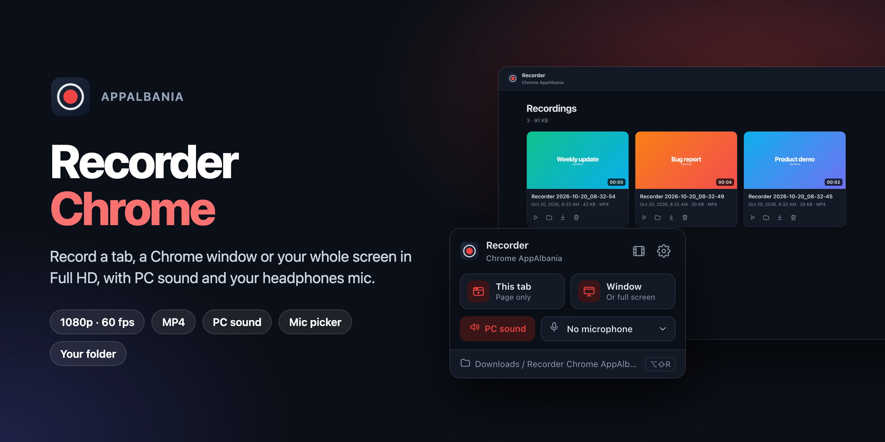
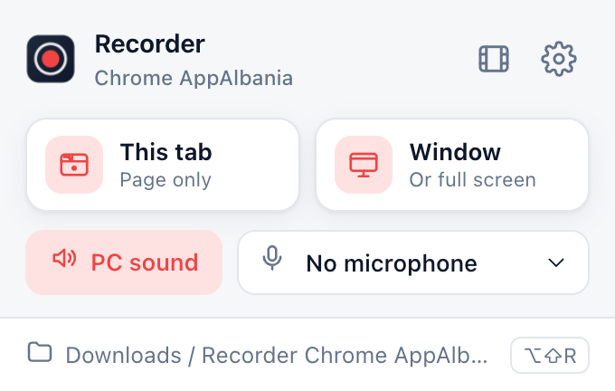
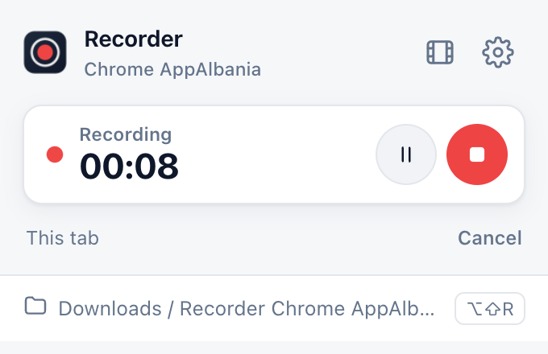
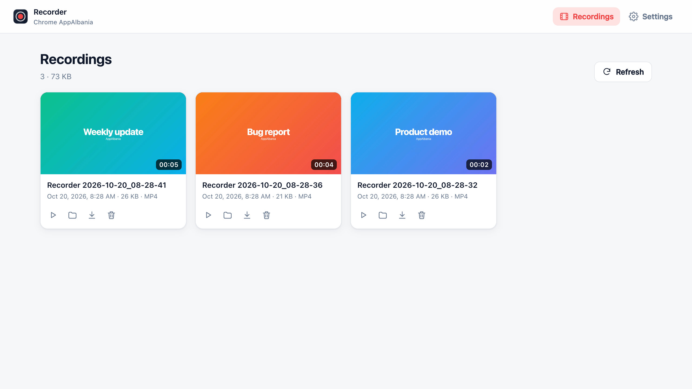
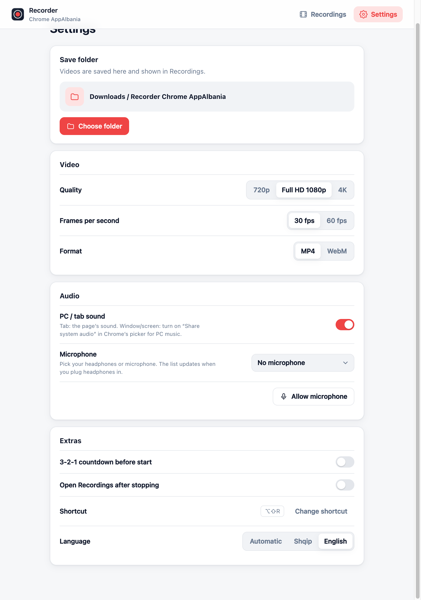

<p align="center">
  
</p>

<h1 align="center">Recorder Chrome AppAlbania</h1>

<p align="center">
  Record a tab in <b>Full HD</b> with sound and your headphones mic, and take screenshots you can draw on.<br>
  Simple, private, no account, everything stays on your computer.
</p>

<p align="center">
  
  
  
  
  
</p>

---

## Features

| | |
|---|---|
| **Record a tab** | Only the page, no browser bars. Pause on one tab and continue on another, all in one video. |
| **Screenshots** | **Select area**, **Visible page** or **Full page** (scrolls and stitches). Draw with pen, line, arrow, rectangle, marker and text in any color, then **Copy**, **Save** (PNG) or **PDF** (A4 pages). Files are named with the site and date, e.g. `Screenshot example.com 2026-10-30_12-31-05.png`. |
| **Full HD** | 720p, **1080p** or 4K at 30 or 60 fps. MP4 (H.264 + AAC) plays everywhere, WebM is optional. |
| **Sound** | Tab sound plus any **microphone**: AirPods, headphones or the Mac mic. |
| **Simple menu** | Click the icon to get the menu. Start, pause, stop. A big 3-2-1 countdown on the page, and the timer shows right on the icon. No new tabs. |
| **Your folder** | Saves to `Downloads/Recorder Chrome AppAlbania` or **any folder you choose** (picking *Documents* creates `Documents/Recorder Chrome AppAlbania`). Screenshots go in its `Screenshots/` folder. |
| **Gallery** | Videos and screenshots in one place, with **All / Recordings / Screenshots** filters and search by name, site or date. Play, view, rename, download, show in folder, delete. |
| **Shortcuts** | <kbd>Alt</kbd> + <kbd>Shift</kbd> + <kbd>R</kbd> starts and stops recording, <kbd>Alt</kbd> + <kbd>Shift</kbd> + <kbd>S</kbd> selects an area for a screenshot. In the editor: <kbd>⌘C</kbd> copy, <kbd>⌘S</kbd> save, <kbd>⌘Z</kbd> undo, <kbd>Esc</kbd> close. |
| **Light & dark** | Follows your system theme. Albanian and English. |

## Screenshots

<table>
  <tr>
    <td align="center" width="50%">
      <picture>
        <source media="(prefers-color-scheme: dark)" srcset="docs/popup-dark.png">
        
      </picture>
      <br><sub><b>Menu:</b> choose tab or window, PC sound and mic</sub>
    </td>
    <td align="center" width="50%">
      <picture>
        <source media="(prefers-color-scheme: dark)" srcset="docs/popup-rec-dark.png">
        
      </picture>
      <br><sub><b>Recording:</b> 3-2-1 countdown, timer, pause, stop</sub>
    </td>
  </tr>
</table>

<picture>
  <source media="(prefers-color-scheme: dark)" srcset="docs/library-dark.png">
  
</picture>
<p align="center"><sub><b>Recordings:</b> all your videos in one place</sub></p>

<details>
<summary><b>Settings</b></summary>
<br>
<picture>
  <source media="(prefers-color-scheme: dark)" srcset="docs/settings-dark.png">
  
</picture>
</details>

## Install

1. Download this repo (**Code → Download ZIP**) and unzip it, or `git clone` it.
2. Open `chrome://extensions` and turn on **Developer mode** (top right).
3. Click **Load unpacked** and choose the `Recorder-chrome` folder.
4. Pin **Recorder Chrome AppAlbania** to the toolbar.

## How to use

1. Click the extension icon.
2. Pick **This tab** to record, or **Screenshot** → *Select area*, *Visible page* or *Full page*.
3. Turn **PC sound** on or off and choose a microphone (or *No microphone*).
4. Press **Stop** when done. The video is saved and shows up in **Recordings**.

> **Microphone:** the first time you pick one, Settings asks for permission once.

## Privacy

Nothing is uploaded. Recordings are written straight to your disk. There are no analytics, no accounts and no servers.

## Project structure

```
manifest.json
icons/                 extension icons
src/
  background.js        start/stop, badge timer, downloads, shortcuts, screenshots + full-page stitching
  offscreen.js         capture + MediaRecorder, writes 1 s chunks to disk
  snip.js              screenshot editor (area select, drawing, copy/save), injected into the page
  shot.*               full-page screenshot editor tab
  popup.*              toolbar menu
  library.*            Recordings page
  options.*            Settings page
  shared.js            settings, translations (sq/en), icons
docs/                  screenshots
```

---

<p align="center">Made by <b>AppAlbania</b></p>
